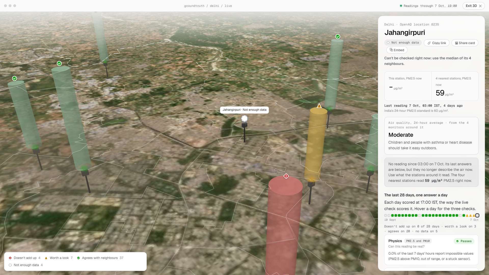
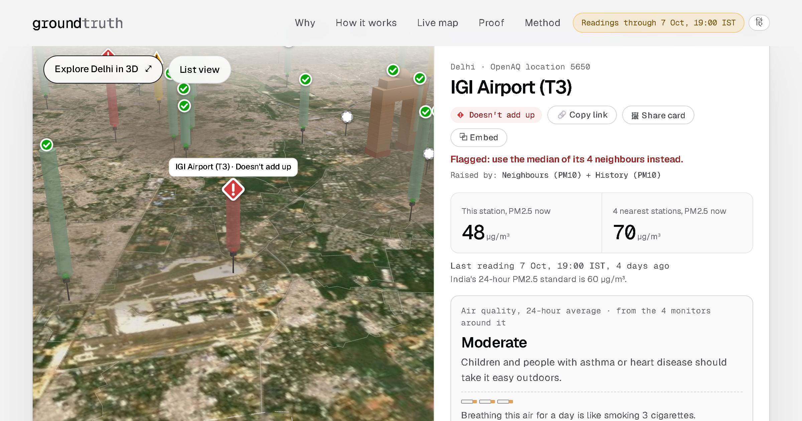
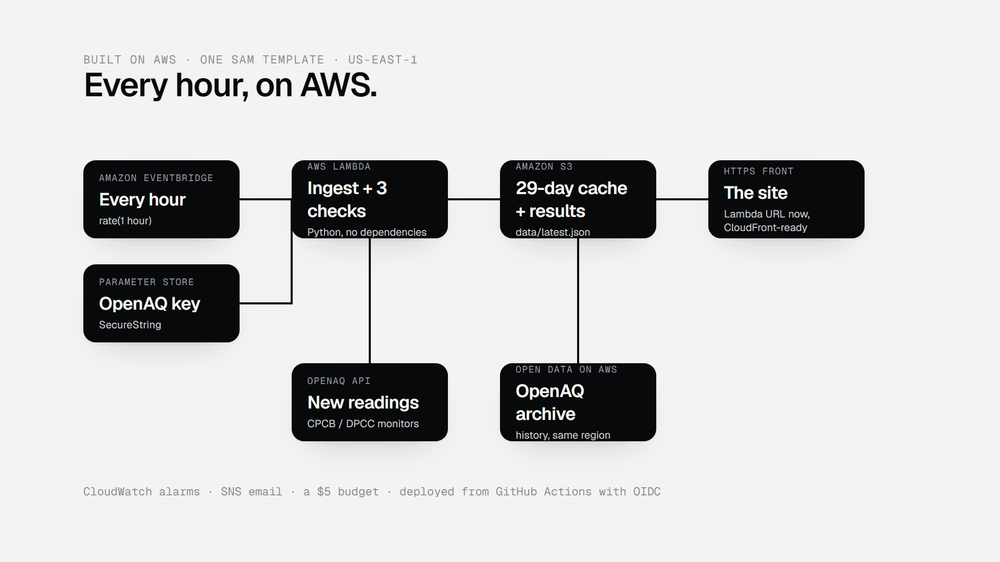

# Who checks the air-quality monitors? An hourly fact-checker for Delhi's air, on AWS

_For AWS Builder Center. Numbers as of 11 Oct 2026 from `docs/VALIDATION.md` and the live site; the pictures are in `docs/img/`. When publishing: paste the text from the title down, upload the PNGs where the image lines are, add up to 5 of Builder Center's tags (it only offers its own list: pick the closest to AWS Lambda, Serverless, Amazon CloudWatch, Open Data, Sustainability), and put the post's URL in `docs/submission.md` and the README._

> **TL;DR.** Delhi's 52 public air-quality monitors drive real decisions, and nobody checks whether they work. Ground Truth checks every one of them every hour (physics, neighbours, history) and answers in plain words, in English and Hindi, with the evidence one click away. It caught 30 of 30 planted faults in real data. It runs on EventBridge, Lambda, S3, CloudWatch and SNS from one SAM template, for about $0.30 a month inside the free tier. Our first idea failed its own test, and the product is better for it.

Every winter, Delhi plans around a number. Schools move assembly indoors when the AQI crosses a line, construction stops, parents keep children home. That number comes from about 40 monitors across the city, and nobody checks the monitors.

In October 2025, water tankers were filmed near one of them. That made us ask a simpler question than "is someone gaming the monitors?": can a person tell, from the published number, whether the monitor behind it is working at all? The answer was no. So for Environmental Hacks we built Ground Truth, which checks every monitor in Delhi and the NCR every hour and gives a plain answer.

## Start with the data, not the idea

Before writing any product code, we spent the first hours on one question: is the data good enough? The public OpenAQ archive, which sits on the Registry of Open Data on AWS, has 52 monitors in the Delhi box at 15-minute resolution. October-November 2025 was 99% complete.

Then we tested the idea we had walked in with. If a monitor is being sprayed with water from 11 in the morning to 5 in the afternoon, its dust reading should fall against its neighbours in those hours while its traffic gases don't. We wrote the method down before looking at the two monitors named in the news, then ran it.

They didn't stand out. Anand Vihar ranked 6th and Jahangirpuri 13th of 38. Anand Vihar does show a clean daytime dip, but every polluted hotspot does: by day the air mixes higher, so a monitor that reads high at night drifts towards its neighbours. Across all monitors, that effect alone explained most of the dip (a correlation of −0.72).

That changed the product. We stopped trying to detect spraying, and built something that finds monitors whose numbers don't add up and shows the evidence.



## Three questions, every hour

- **Physics:** can the reading be real? Fine dust (PM2.5) is part of all dust (PM10), so it can never be bigger. In Oct-Nov 2025, one Gurugram monitor broke that rule in 31% of hours.
- **Neighbours:** does it agree, hour by hour, with the four nearest monitors? We correct for daytime mixing with a robust line fitted across the whole city.
- **History:** has it suddenly changed against its own last three weeks?

When a monitor is in doubt, the site shows what its four neighbours read right now. That is the number a principal can actually use.

Then we asked what each reader does next, and built for that:

- **A principal** sees *when the air is cleanest*: the last week's PM2.5 by hour of day, from the reading you can trust, with the cleanest three hours between 7:00 and 19:00 marked. Delhi's air is usually cleanest mid-afternoon, when it mixes highest, but each monitor gets its own measured week, not a textbook curve.
- **A parent** sees the day's air *in cigarettes*. Berkeley Earth estimated that breathing 22 µg/m³ of PM2.5 for a day does about the harm of one cigarette (Muller and Muller, 2015). On CPCB's scale a "Poor" day (91-120 µg/m³) is four to five cigarettes, and a "Very poor" one can be ten.
- **The people who run the monitors** get a list called *Fix these first*: the monitors that didn't add up on the most of the last 28 days, each with its month as a strip and the check that caught it most often. It turns the checks into work orders.
- **Everyone** can read it in Hindi: one button switches the whole site, including each monitor's answer and its evidence, and a test fails if any phrase is left in English.



We also scored every day of October and November 2025 the way the live site would have. On an ordinary day, about 21 in 100 judged monitors got "doesn't add up" and 27 in 100 "worth a look". Most flags came from the physics check, 7.6 a day: readings that cannot be real, whatever the air is doing. The neighbours and history checks raised 2.9 flags a day between them.

## How do you know it works?

We tried to fool it. In real November 2025 data we lowered one quiet monitor's daytime dust by 40%, one monitor at a time. It caught all 30. It also wrongly flagged three other monitors across all 30 runs, and that number is how we found and fixed the hardest bug.

At first, one doctored monitor dragged its neighbours with it, because it sat inside their reference. The fix was a second pass: monitors flagged in the first pass are left out of everyone else's reference in the second. That test, and 96 others, runs on every change. A planted 30% drop was caught 29 times out of 30, and a 20% drop 10 times out of 30: we say how far the method reaches, not just where it works.

## On AWS

The whole thing is one SAM template in us-east-1, next to the archive it reads.



- EventBridge triggers a Python Lambda every hour.
- The Lambda reads new readings from the OpenAQ API (with the key in Parameter Store), runs the checks, and writes JSON to S3.
- The site is served from that bucket over HTTPS. CloudFront is in the template, but a new account can't create distributions until AWS Support verifies it, so a second small Lambda behind a function URL serves the bucket with the same security headers until then.
- Each run publishes custom CloudWatch metrics: how old the data is, whether the run finished, and how many monitors got each answer that hour. One CloudWatch dashboard shows them next to the Lambda's own metrics and a Logs Insights table of the last 24 runs.
- A second, tiny Lambda checks the site from the outside every 15 minutes, the way a visitor would: it loads the page and the data and records whether the site is up and how fast it answered. The inside metrics can't see a broken permission or a bad deploy; this can.
- CloudWatch alarms and a $5 budget email us through SNS if a run fails, if the data goes stale, if the site goes down for a visitor, or if the bill moves. A merge to main deploys through GitHub Actions with OIDC; no AWS keys are stored anywhere.
- Running it costs cents: about 720 Lambda runs a month (about 110,000 GB-seconds on arm64), 10 MB in S3, and metrics and alarms inside the free tier. That is about $0.30 a month inside the free tier and about $3 without it.

Five things fought back:
1. **The archive runs about four days behind,** so live hours come from the API.
2. **CloudFront was off for our account** until verified, which cost a rolled-back first deploy and taught us that a function URL plus the right headers is a fine HTTPS front for a small site.
3. **The API averages over UTC hours.** India is UTC+5:30, so its "hours" run 13:30 to 14:30. Mixing those with archive hours would have shifted our 11-to-5 window by half an hour for live data only. We group the raw 15-minute readings into Indian hours ourselves.
4. **A public function URL needs two permissions since 2025.** With only the first one below, every request is a 403 `Forbidden`, and nothing in the error says why. This is the pair in our template, in case it saves you an afternoon:

```yaml
ServeFunctionUrlPermission:
  Type: AWS::Lambda::Permission
  Properties:
    FunctionName: !Ref ServeFunction
    Action: lambda:InvokeFunctionUrl
    Principal: "*"
    FunctionUrlAuthType: NONE

ServeFunctionUrlInvokePermission:   # the one that's easy to miss
  Type: AWS::Lambda::Permission
  Properties:
    FunctionName: !Ref ServeFunction
    Action: lambda:InvokeFunction
    Principal: "*"
    InvokedViaFunctionUrl: true
```

5. **A new account's Lambda concurrency limit is 10.** When several people opened the site at once, requests were throttled. The fix had three parts: the serve Lambda keeps files in memory for a short time, the page retries a throttled request, and we asked Service Quotas for a higher limit.

And one we couldn't fix: on 7 Oct 2026 the CPCB feed stopped reaching OpenAQ. OpenAQ's own page for Anand Vihar says "Updated 4 days ago". Our hourly run kept going, and instead of looking broken, the site says the feed is behind, by how much, and links to OpenAQ's page so anyone can check.

## What we learned

- Test the idea against the data before building the product. Ours didn't survive, and the product got better.
- A tool that refuses to over-claim is more convincing than one that accuses.
- Show where every number comes from and how fresh it is, especially when the source stops.
- Watch the system from where the user stands, not only from inside it.

## Run it yourself

Everything is open source, and the site runs locally with real sample data and no AWS account:

```bash
git clone https://github.com/thegoodengineers/ground-truth
cd ground-truth
make setup && make local     # http://localhost:8000, add ?demo=1 for the narrated tour
make deploy ALERT_EMAIL=you@example.com   # your own stack, with an AWS profile
```

The city is a setting (`src/regions/<city>.json`). Mumbai already scores from the archive; its feed isn't complete enough to publish yet, and we say so rather than ship answers the data can't support.

**Try it:** https://zsx5rsh4vklo266budro23qama0cpbpi.lambda-url.us-east-1.on.aws/ · **Code:** https://github.com/thegoodengineers/ground-truth

_Built for Environmental Hacks 2026 (Air track) by team thegoodengineers: Chirag, Abhijeet, Bhumika and Ayush._
